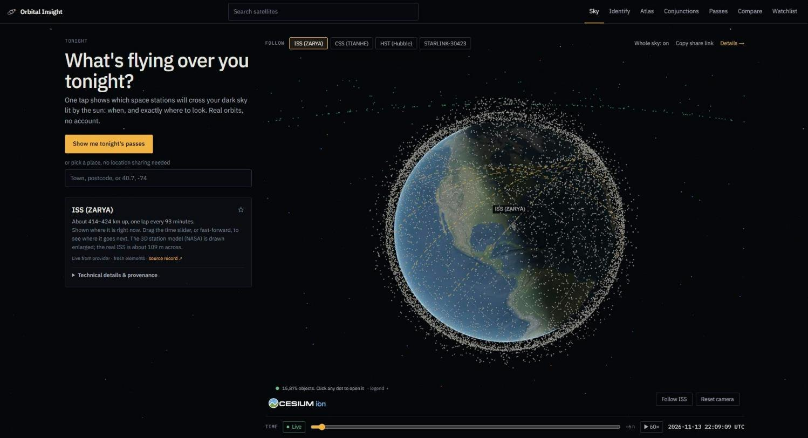
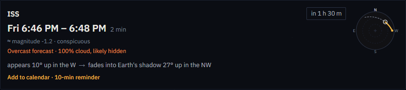
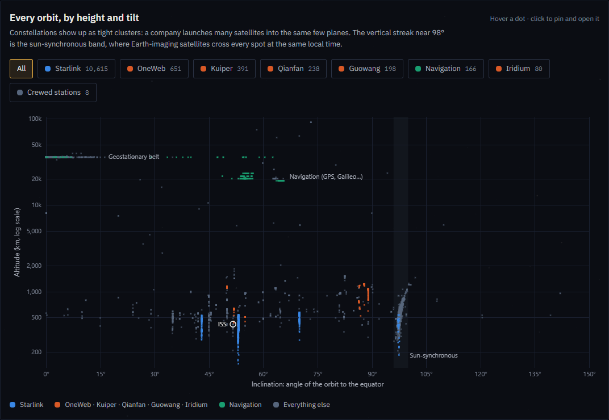
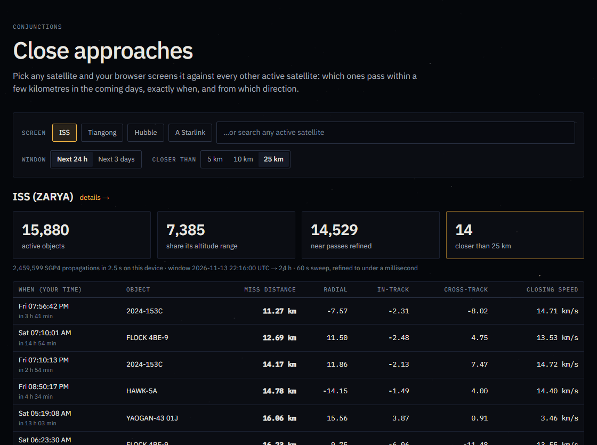

<p align="center">
  <picture>
    <source media="(prefers-color-scheme: dark)" srcset="docs/images/mark-dark.svg">
    
  </picture>
</p>

<h1 align="center">Orbital Insight</h1>

<p align="center">
  <a href="https://orbital-insight-drab.vercel.app"><b>Open the site</b></a>
  &nbsp;·&nbsp;
  <a href="docs/architecture.md">How it fits together</a>
  &nbsp;·&nbsp;
  <a href="https://orbital-insight-drab.vercel.app/methodology">Methodology</a>
  &nbsp;·&nbsp;
  <a href="https://github.com/Devligan/orbital-insight/actions/workflows/ci.yml"></a>
</p>

A website for looking up. It tells you which satellites will cross your sky tonight and where to look, works out
what that moving light you just saw probably was, and puts every active satellite on a live globe. The orbits are
real (public element sets from CelesTrak), and the maths runs in your browser.

No account, nothing to install.



## What you can do

- **See what's up tonight.** Type a town (or share your location) and get the passes you can actually see: only
  ones where the satellite is sunlit against a dark sky. Each comes with a little chart of your sky, the direction in
  compass words, how high in fists at arm's length, the forecast cloud cover, and a calendar reminder.
- **Identify a sighting.** Saw a steady light glide past? Say when and which way you were looking, and the whole
  catalog is checked against your sky for that moment.
- **Explore the globe.** About 16,000 objects, propagated live. Follow the ISS, scrub time forward, click any dot.
- **See who's in orbit.** Every satellite by orbit height and tilt, where Starlink's shells, the sun-synchronous
  band and the geostationary ring jump out.
- **Screen for close approaches.** Pick a satellite and check it against everything else for the next few days.



| Who's in orbit | Close approaches to the ISS |
| --- | --- |
|  |  |

## A few problems worth reading about

**"Visible" is not the same as "overhead."** Most passes can't be seen: the satellite is in Earth's shadow, or your
sky is still bright. A pass only counts here if the satellite is sunlit while the sun is at least 6° below your
horizon, and the visible stretch is found by bisection to about a second, so the chart's bright line starts and ends
where the text says. Brightness is estimated only for objects with a published standard magnitude. Everything else
says "brightness unknown" instead of guessing.

**Identifying a light means searching the whole sky at once.** For a reported sighting, a Web Worker propagates
every active satellite every 10 seconds across a few minutes (about 780,000 SGP4 runs, a second or two on a laptop)
and keeps the ones that were up, lit, moving and near where you looked. "NW, halfway up" is an arc of sky, so the
distance to it is solved in closed form rather than to a single point. The pass predictor is a separate piece of
code, which makes it a handy oracle: the tests ask the search about every moment the predictor calls a satellite
visible, and it has to name that satellite within 1°.

**Screening close approaches without brute force.** The screener sweeps the chosen satellite against each candidate in 60-second
steps, but two objects in Earth orbit can't close faster than about 16 km/s. So from a separation *d*, nothing can come within the threshold
for *(d − threshold) / 16 km/s*, and the sweep skips ahead by exactly that much. That took the ISS from 11.5 million
propagations in 10 seconds to 2.4 million in about 2.5, with identical results (a test checks against the brute-force
sweep).

**Checking the orbit maths against the reference.** SGP4 comes from satellite.js, and the tests regenerate all 700
rows of the official `SGP4-VER` verification suite and compare them to the published output at 2 × 10⁻⁷.

**Not leaning on the data provider.** CelesTrak is a free public service, and it once refused the
full-catalog query from Vercel's servers while answering everyone else. Each deployment now carries its own copy of
the catalog, labelled with its real age and refreshed by a scheduled job, so a cold server never waits on CelesTrak.

More on how it fits together, and the bugs that shaped it, is in [docs/architecture.md](docs/architecture.md) and on
the site's [How it's built](https://orbital-insight-drab.vercel.app/engineering) page. Every approximation is listed
on [Methodology](https://orbital-insight-drab.vercel.app/methodology).

## Running it

```bash
npm install
npm run dev       # http://localhost:3000, no environment variables needed
npm test          # unit and integration tests
npm run verify    # everything CI runs: types, lint, tests, production build, bundle budget, browser tests
```

Built with Next.js, satellite.js and CesiumJS, deployed on Vercel. Pull requests run the full suite in GitHub
Actions, and each production deployment gets a smoke test against its live URL.

## Data and limits

Orbital elements come from [CelesTrak](https://celestrak.org/). Town search and cloud forecasts come from
[Open-Meteo](https://open-meteo.com/) (CC BY 4.0, places from GeoNames). Positions are SGP4 predictions from public
element sets, good to roughly a kilometre near their epoch and with no uncertainty estimate, so this is for looking
up and exploring. It is **not for navigation, safety or collision-avoidance decisions**.

Made by [Devligan](https://github.com/Devligan).
