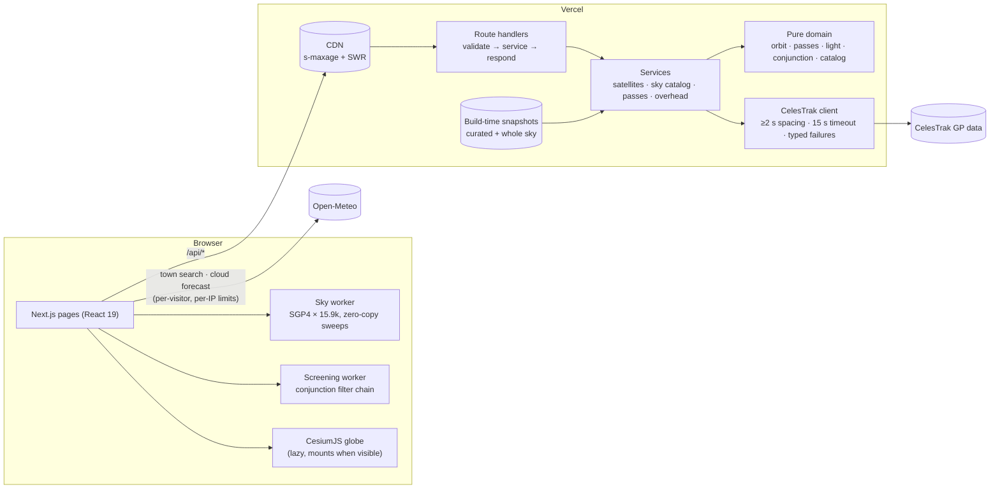
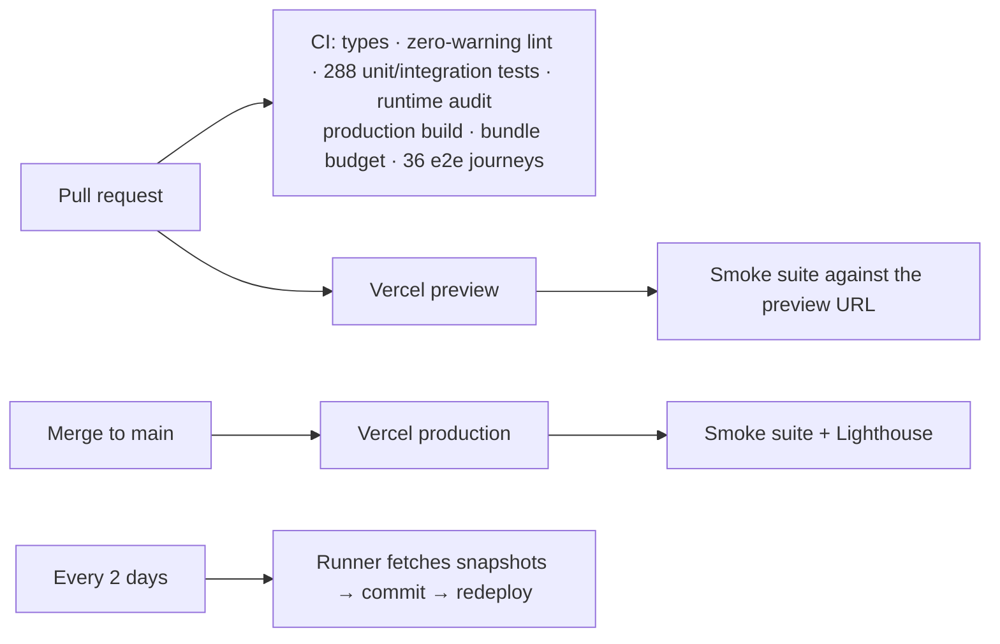

# Orbital Insight

[](https://github.com/Devligan/orbital-insight/actions/workflows/ci.yml)

**Real satellites, real orbits, in the browser.** Every active satellite in the public catalog (~15,900 objects)
propagated with SGP4 on a live 3D globe; *"can I actually see it tonight?"* pass prediction with sunlight and
sky darkness modelled; a constellation atlas of who is in orbit and where; and **close-approach screening** of any
satellite against the whole catalog, computed on your device.

**Live:** https://orbital-insight-drab.vercel.app · no sign-in, no API keys


| Constellation atlas | Close-approach screening |
| --- | --- |
|  |  |

## What's interesting under the hood

**Conjunction screening in a Web Worker** ([`src/domain/conjunction/screening.ts`](src/domain/conjunction/screening.ts))
A filter chain after Hoots, Crawford & Roehrich (1984). First a perigee/apogee radius filter. Then a 60 s sampled sweep
in which a local minimum provably brackets each approach: separation can't shrink faster than 16 km/s, so minima
further out than *threshold + 16 km/s × step* are discarded unrefined. Golden-section search pins the time of
closest approach to under a millisecond, and the miss vector is resolved into the target's radial / in-track /
cross-track frame. The same speed bound drives **conservative time skipping**: from separation *d*, nothing can get
within the threshold for *(d − threshold) / 16 km/s*, so the sweep jumps ahead. Screening the ISS dropped from
11.5 M propagations in 10 s to 2.4 M in ~2.5 s, with identical results. A unit test proves the skipping and
brute-force sweeps agree. Tests use an exact oracle: two-body orbits engineered to meet at a known instant and
distance. Docked modules, which share one element set and have no separation minimum, are classified co-orbiting
instead of vanishing or flooding the list.

**SGP4 validated against the official reference** ([`tests/unit/propagation.test.ts`](tests/unit/propagation.test.ts))
The integration regenerates all **700 published rows** of the `SGP4-VER.TLE` verification suite (33 element sets,
including the deep-space and edge cases) and demands |Δ| < 2 × 10⁻⁷ on every TEME component, the tolerance the
upstream harness uses.

**15,900 objects at interactive frame rates** ([`src/features/sky`](src/features/sky))
A worker propagates the whole catalog and hands positions and velocities back as transferred `Float32Array`s.
Between SGP4 sweeps each dot is dead-reckoned along its velocity (error bound unit-tested), redraw cadence follows
zoom and time rate, and Cesium's one-time shader compiles are forced during load, not mid-drag. Idle CPU went from
~18% to ~5%. The 1.3 MB globe mounts only when visible, and a CI bundle-budget gate keeps it off the critical path.

**Visibility, not just geometry** ([`src/domain/light`](src/domain/light))
A pass counts only if the satellite is sunlit (Earth's shadow cylinder) while the observer's sky is past civil
twilight. Brightness is estimated only from sourced standard magnitudes (Mallama 2020 convention); everything else
reads "brightness unknown" rather than an invented number.

**Where to look, drawn** ([`sky-chart-geometry.ts`](src/features/pass-prediction/sky-chart-geometry.ts),
[`pass-calendar.ts`](src/features/tonight/pass-calendar.ts))
Every pass is plotted on a chart of the observer's sky (zenith at the centre, east on the left as in a star chart).
The faint arc is the geometric pass; the bright line is only the stretch where the satellite is sunlit against a dark
sky, drawn between the bisection-refined window edges rather than coarse samples, with a ring where it slips into
Earth's shadow. One tap turns a visible pass into an RFC 5545 calendar event with a 10-minute alarm, built in the
browser. The tests check that format against the spec itself (75-octet folding that never splits a UTF-8
character, TEXT escaping, stable UIDs) rather than against a snapshot.


**Built for the person outside, not just the orbit** ([`place-search.tsx`](src/features/observer/place-search.tsx),
[`cloud-outlook.ts`](src/features/tonight/cloud-outlook.ts))
These features started from a survey of what casual watchers actually use (Heavens-Above, ISS Detector, FindStarlink,
NASA's Spot the Station) and where those tools let them down. Every one of them starts with *type your town*, so
this one does too, and it remembers the spot in the browser so a return visit skips the question. Each visible pass carries
the forecast cloud cover for its minute (interpolated from hourly model output, never bridged across a missing
hour) and the peak height in fists at arm's length, the one measuring tool everyone carries. Both third-party calls
go from the visitor's browser, not the server, because Open-Meteo rate-limits per IP. Their responses are checked by
hand instead of with Zod: the bundle budget caught Zod adding 27 kB to the home page.

**Honesty as a contract** ([`/methodology`](https://orbital-insight-drab.vercel.app/methodology))
Every response carries data lineage (`live` / `cached` / `provider-unavailable-stale`). Provider failures are typed
failures, never fabricated orbits, and every approximation and limit is documented on the methodology page.

## Architecture



- **Dependency direction is one-way:** routes → services → pure domain. The domain never imports React, HTTP or a
  database, and only `src/integrations/sgp4` touches `satellite.js`.
- **No request-time dependency on the provider:** each deployment ships a build-time snapshot of the whole active
  catalog (refreshed every two days by a scheduled job). Cold servers answer from it at once, with its real age, and
  refresh from CelesTrak in the background. This was added after CelesTrak was found refusing the full-catalog
  query from Vercel's servers while serving other networks.
- **Provider politeness is designed in:** one shared fetch of the active catalog per 6 h per instance, a CDN window
  of 3 h in front of it, disk snapshot restore, 10 min back-off after failures, and refusal of truncated feeds.
- Details: [`docs/architecture.md`](docs/architecture.md).

## Delivery pipeline



Workflows live in [`.github/workflows`](.github/workflows). The smoke suite's headline assertion is "no uncaught
page errors", added after a minifier-mangled Cesium chunk once reached production while every other check was green.
Dependabot groups routine bumps; Cesium minors are held for deliberate upgrades with production screenshots.
The pipeline's own config is tested too ([`tests/unit/workflows.test.ts`](tests/unit/workflows.test.ts)): an
unquoted `: ` in a step name once made the data-refresh workflow unparseable, and GitHub silently never schedules
an invalid workflow. Layout stability has an e2e guard: `/atlas` once measured CLS 0.85 under Lighthouse, and is
now held at 0 while its 1.6 MB catalog loads.

## Features

| Route | What it does |
| --- | --- |
| `/` | Hero answer to "what's flying over me tonight?" (find your spot by town, postcode or coordinates, remembered between visits; visible passes only, local times, compass words and heights in fists, a sky chart and a cloud forecast for each pass, add-to-calendar with a reminder) next to the live globe: every active satellite, follow the ISS with NASA's 3D model, time slider and 60× fast-forward, shareable links |
| `/atlas` | All active satellites by inclination and altitude, a 10 km altitude histogram that shows each constellation shell, and a constellation table |
| `/conjunctions` | Close-approach screening of any satellite against the active catalog: TCA, miss distance (RIC), closing speed, encounter profile |
| `/satellites/[id]` | Element set, epoch and provenance, approximate orbit characteristics, 24 h ground track |
| `/passes` | Pass predictions for any town or coordinates, opening on your remembered spot (rise / peak / set, azimuths, visibility verdict, sky chart per pass), CSV export |
| `/compare` | Two element sets compared, with propagated-position deltas over time |
| `/watchlist` | Browser-local watchlist (no account) |
| `/methodology` | Data sources, frames, validation, every approximation and limit |

## Stack

Next.js 15 (App Router) · React 19 · TypeScript (strict) · Tailwind CSS 4 · satellite.js 7 (SGP4) · CesiumJS ·
Zod 4 at every boundary · Vitest · Playwright · GitHub Actions · Vercel. Supabase persistence is optional; the app
runs fully without it.

## Run it

```bash
npm install
npm run dev          # http://localhost:3000, no environment variables needed
npm run verify       # typecheck → lint → tests → production build → bundle budget → e2e
```

| Command | What it runs |
| --- | --- |
| `npm test` | Vitest unit + integration (288; the one skip is an opt-in live-provider check: `RUN_LIVE_TESTS=1`) |
| `npm run test:e2e` | Playwright journeys against `next start` (production build first) |
| `npm run test:smoke` | The deployment smoke suite; point it anywhere with `E2E_BASE_URL=https://…` |
| `npm run check:bundle` | First-load JS per page (gzip) against budgets |

Tip: if a `next dev` server shares the checkout, build and test with `NEXT_DIST_DIR=.next-prod` so the two don't
overwrite each other's output.

## Evidence

- [`docs/verification.md`](docs/verification.md): the feature-by-feature verification matrix (what was checked, how,
  measured numbers)
- [`docs/engineering-audit.md`](docs/engineering-audit.md): an independent audit with findings and fixes
- [`docs/architecture.md`](docs/architecture.md): module boundaries and key decisions

## Data and limits

Orbital elements come from [CelesTrak](https://celestrak.org/) (public GP data, attributed, cached politely).
Positions are SGP4 predictions from public element sets: kilometre-level accuracy, no covariance. That makes this
a tool for exploring and screening, **not for navigation, safety, or collision-avoidance decisions**. Town search
and cloud forecasts come from [Open-Meteo](https://open-meteo.com/) (CC BY 4.0; places from GeoNames).

## Author

Designed and built by [Devligan](https://github.com/Devligan). The site credits its author in the footer and on
[`/engineering`](https://orbital-insight-drab.vercel.app/engineering). A deployment can set
`NEXT_PUBLIC_AUTHOR_NAME` / `NEXT_PUBLIC_AUTHOR_URL` to change the credit without a code change.
