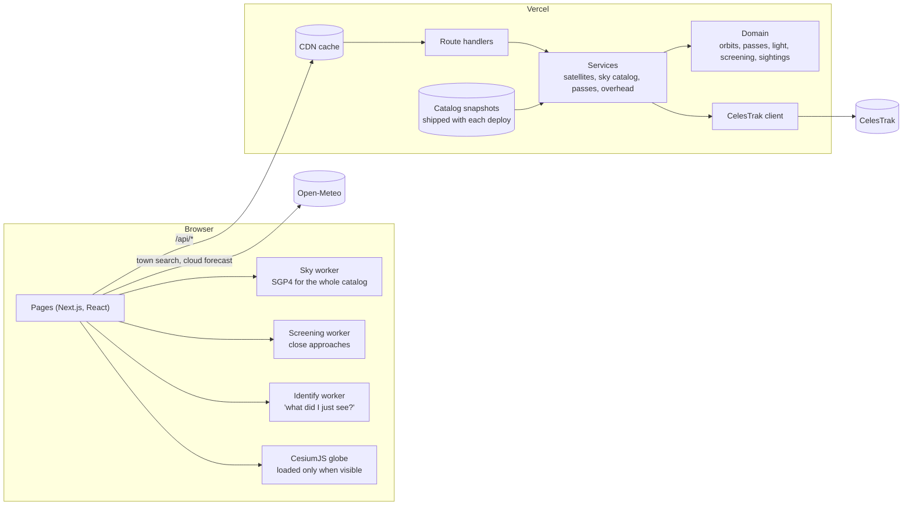

# How Orbital Insight fits together

Most of the work happens in the visitor's browser. The server's job is to fetch public orbital data, check it,
cache it, and answer small questions (passes for a few satellites, what's overhead) quickly.



## Layers

```
src/app            pages and thin route handlers (validate input, call a service, map errors to HTTP)
src/features       UI for each area, plus the Web Workers
src/server         services: caching, provider orchestration, optional persistence
src/domain         the maths: no React, no HTTP, no database, tested in plain Node
src/integrations   the only code that talks to outside things: satellite.js, CelesTrak, Open-Meteo, time zones
src/contracts      shared request/response schemas (zod)
```

Dependencies only point downward. Only `src/integrations/sgp4` imports satellite.js, and it has two halves:
`adapter.ts` for the server (it maps failures to the server's error type) and `bulk.ts` for workers (no
server-only imports, no allocation on the hot path). Browser code never imports server modules. That rule is not
just tidiness: one stray import once pulled `node:crypto` into a browser bundle and broke the build.

## Orbits and frames

- Element sets are TLEs from CelesTrak's GP interface. SGP4 (satellite.js, a port of Vallado's reference code)
  returns TEME position and velocity in km and km/s, with time as minutes from the element-set epoch.
- TEME to Earth-fixed uses Greenwich mean sidereal time. Polar motion and UT1−UTC are ignored; both are far below
  what a TLE can promise.
- Look angles (azimuth, elevation, range) follow satellite.js's WGS-72 geodetic model. The sighting search unrolls
  the same algebra to avoid allocating per call, and a test checks it against satellite.js to nine decimal places.
- Times are UTC internally. Pass times are shown on the observer's wall clock, with the zone looked up offline from
  the coordinates.

## Data and caching

- **Curated objects** (stations, Hubble, a handful of others) are cached per satellite. A copy under a day old is
  answered at once and refreshed in the background, so a slow provider never holds a page up.
- **The whole active catalog** (about 16,000 objects, for the globe, atlas, screening and sightings) is fetched at
  most once per 6 hours per server, with concurrent requests sharing one fetch. The CDN holds it for 3 hours in
  front of that. Answers under 5,000 objects are refused as truncated. After a failure the server backs off for 10
  minutes. A fetched copy is served (labelled stale) for up to 48 hours.
- **Each deployment ships its own snapshot** of the catalog, refreshed by a scheduled job every two days, and
  served for up to a week with its real age. This exists because CelesTrak once refused the full-catalog query from
  Vercel's servers while answering other networks.
- Every response says where its data came from: `live`, `cached`, or `provider-unavailable-stale`. A failure is a
  typed error with a status code, never an invented orbit.
- **Open-Meteo** is called from the browser, not the server. Its free tier is limited per IP address, and every
  visitor sharing one server address would use it up. The forecast is asked for at about 1 km precision.

## Keeping compute bounded

- Pass requests are capped at 25 satellites and a 30-day window. Ground tracks are capped at 48 hours.
- The heavy jobs (the whole-sky globe, close-approach screening, sighting search) run in the visitor's browser in
  Web Workers, so they cost the server nothing and never block the page.
- The 1.3 MB globe is loaded only when it scrolls into view. A CI check fails any page whose first-load JavaScript
  exceeds its budget; it caught a validation library adding 27 kB to the home page.

## Tests

- **Unit** (`tests/unit`): the orbital maths. That includes all 700 rows of the official SGP4 verification suite at
  2 × 10⁻⁷, sunlight and shadow geometry, pass finding and its edge cases, screening against an exact two-body
  oracle, and the sighting search against the pass predictor.
- **Integration** (`tests/integration`): the CelesTrak client against malformed, slow and rate-limited responses,
  route handlers, and the catalog service's fresh, refreshing, stale and expired cases.
- **Browser** (`tests/e2e`): Playwright journeys against a production build. Several assert what Cesium actually
  holds (its clock, the ISS's altitude) rather than what a readout says, after a readout-only test once passed while
  the globe sat frozen.

## Delivery

Every pull request runs types, lint (no warnings allowed), the unit and integration tests, a production build,
the bundle budget and the browser journeys. Vercel builds a preview for each branch. Merging to `main` deploys
production, and a follow-up workflow runs a smoke suite and Lighthouse against the live URL. The smoke suite's main
assertion is "no uncaught page errors", added after a minifier-mangled Cesium chunk reached production while every
other check was green. The workflows are tested too: an unquoted colon once made one of them invalid YAML, and
GitHub silently never ran it.
